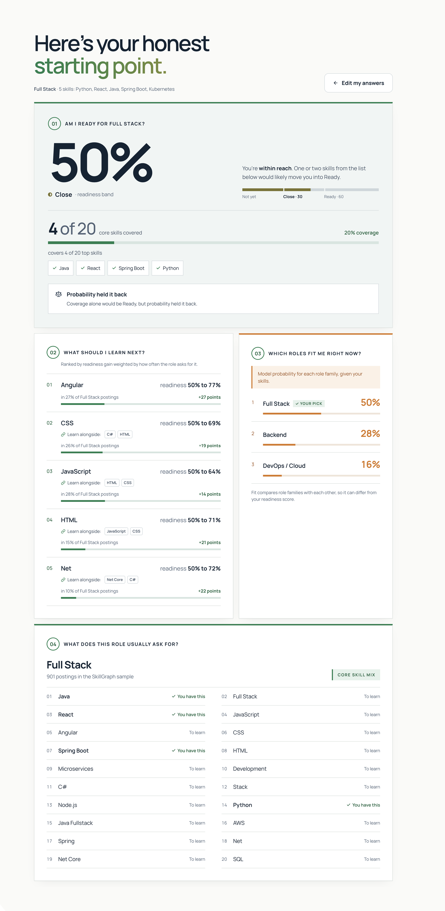
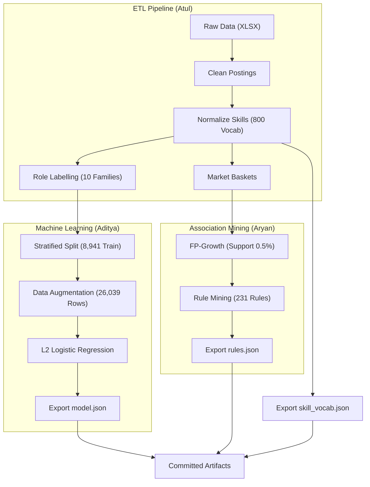
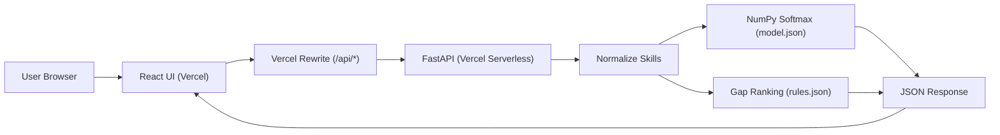

# 🧭 SkillGraph: India Job Market Mining Engine

SkillGraph maps applicant skill profiles to Indian technology roles, predicts readiness with qualitative bands, and recommends prioritized skill additions with co-occurrence companions. The system is built from 12,872 labelled Indian tech job postings, association rule mining with FP-growth, and a calibrated logistic regression classifier.

[](https://www.python.org/)
[](https://fastapi.tiangolo.com/)
[](https://react.dev/)
[](https://vitejs.dev/)
[](https://vercel.com/)
[](https://skillgraph-exp.vercel.app)
[](https://www.tella.tv/video/skillgraph-are-you-ready-for-your-tech-role-f2uz)

---

## 🎬 Video Walkthrough

<p align="center">
  <a href="https://www.tella.tv/video/skillgraph-are-you-ready-for-your-tech-role-f2uz" target="_blank" rel="noopener noreferrer">
    
  </a>
</p>

<p align="center">
  <a href="https://www.tella.tv/video/skillgraph-are-you-ready-for-your-tech-role-f2uz" target="_blank" rel="noopener noreferrer">
    ▶️ <b>Watch the video walkthrough on Tella</b>
  </a>
</p>

---

## 🌐 Live Deployment

| Service | URL |
|---|---|
| **Web Application** | [skillgraph-exp.vercel.app](https://skillgraph-exp.vercel.app) |
| **Video Walkthrough** | [tella.tv/video/skillgraph-are-you-ready-for-your-tech-role-f2uz](https://www.tella.tv/video/skillgraph-are-you-ready-for-your-tech-role-f2uz) |
| **API Health** | [skillgraph-api-notionatul.vercel.app/api/health](https://skillgraph-api-notionatul.vercel.app/api/health) |
| **API Documentation** | [skillgraph-api-notionatul.vercel.app/docs](https://skillgraph-api-notionatul.vercel.app/docs) |
| **Data Release** | [GitHub Release data-v4](https://github.com/AtulACleaver/SkillGraph/releases/tag/data-v4) |
| **Model Release** | [GitHub Release model-v4](https://github.com/AtulACleaver/SkillGraph/releases/tag/model-v4) |
| **Rules Release** | [GitHub Release rules-v2](https://github.com/AtulACleaver/SkillGraph/releases/tag/rules-v2) |

---

## 📸 Preview

<p align="center">
  
</p>

---

## ✨ Features

- **Readiness scoring with qualitative bands**: Probability outputs pair with role top-20 skill coverage to place applicants in Ready, Close, or Not yet.
- **Top 3 role family matches**: Softmax probabilities rank the closest career tracks from 10 calibrated role distributions.
- **Ranked skill gap recommendations**: Counterfactual probability gains multiplied by empirical posting frequency identify the top 5 skills to learn next.
- **Companion skill discovery**: Mined association rules surface co-occurring tools at lift >= 1.50 for combined learning.
- **Fast autocomplete over aliases**: Prefix search indexes 800 canonical vocabulary skills and 834 synonyms from `taxonomy/skill_aliases.csv`.
- **Immediate input validation**: Unrecognized skills and out-of-domain inputs return structured feedback before analysis.
- **Single-request evaluation**: The `/api/analyze` endpoint executes matching, readiness calibration, and gap ranking in one round trip.
- **One-command pipeline rebuild**: A single `make all` command runs extraction, cleaning, normalization, training, and rule generation.

---

## 🎯 How It Works

### The Data and Mining Pipeline



### Serving Architecture



### Readiness Decision Rules

Readiness bands require satisfying both a probability threshold and a role coverage threshold (`ml/predict.py`). The final band is the minimum of the two.

| Band | Probability Requirement | Role Top-20 Coverage Requirement | Interpretation |
|---|---|---|---|
| **Ready** | Probability >= 0.60 | Coverage >= 0.20 | Strong fit across both model probability and core skills |
| **Close** | Probability >= 0.30 | Coverage >= 0.10 | Within reach, 1 to 2 skills away from target role expectations |
| **Not yet** | Probability < 0.30 | Coverage < 0.10 | Early starting point, foundational skills missing |

### Gap Scoring and Rule Constraints

Skill gaps rank candidate competencies by potential impact on readiness (`mining/gap.py`).

| Component | Rule / Cutoff | Source File |
|---|---|---|
| **Gap Score** | Score = Delta Readiness × Empirical Role Coverage | `mining/gap.py` |
| **Readiness Gain** | Counterfactual probability delta via `ml.predict.delta_readiness` | `ml/predict.py` |
| **Companion Lift** | Lift >= 1.50 for co-occurring gap skills | `mining/gap.py` |
| **Non-Learnable Filter** | Excludes non-learnable tokens from `taxonomy/non_learnable.txt` | `taxonomy/non_learnable.txt` |
| **Redundancy Filter** | Prunes synonyms and word subsets via `_is_redundant_skill` | `mining/gap.py` |

---

## 📊 Results

The table below summarizes dataset, model, mining, and latency metrics across the repository.

| Metric | Value | Source |
|---|---|---|
| Labelled Postings | 12,872 | `data/stats/label.json` |
| Role Families | 10 | `taxonomy/role_families.csv` |
| Vocabulary Size | 800 | `artifacts/skill_vocab.json` |
| Mapped Mass | 65.4% (177,432 / 271,108) | `docs/stats.json` |
| Test Macro F1 | 0.7499 | `artifacts/metrics.json` |
| Test Accuracy | 0.7527 | `artifacts/metrics.json` |
| Test Top-3 Accuracy | 0.9254 | `artifacts/metrics.json` |
| Majority Baseline Accuracy | 0.1774 | `artifacts/metrics.json` |
| Short-Input Test Macro F1 | 0.6116 | `artifacts/metrics.json` |
| ECE (Pooled OvR) | 0.0120 | `artifacts/metrics.json` |
| ECE (Top-Label) | 0.0614 | `artifacts/metrics.json` |
| Mined Association Rules | 231 | `artifacts/rules.parquet` |
| Apriori Mining Time (0.5% Sup) | 43.6936 s | `docs/bench.json` |
| FP-Growth Mining Time (0.5% Sup) | 0.3454 s | `docs/bench.json` |
| Mining Speedup | 126.49x | `docs/bench.json` |
| Production Latency (p50) | 454.4 ms | `docs/deploy.md` |
| Production Latency (p95) | 728.8 ms | `docs/deploy.md` |
| Production Cold Start | 2521.1 ms | `docs/deploy.md` |

Logistic regression shipped over LightGBM because LightGBM scored 0.7648 test macro F1 against logistic regression at 0.7499, a difference of 1.49 percentage points that fell short of the required 3.0-point threshold.

---

## 🧪 Benchmark Methodology

Detailed documentation is available in [docs/model.md](docs/model.md), [docs/mining.md](docs/mining.md), and [docs/deploy.md](docs/deploy.md).

### 1. Model Evaluation
- **Splits**: 8,941 raw train rows expanded to 26,039 via data augmentation (`ml/augment.py`), 1,916 validation rows, and 1,917 test rows.
- **Augmentation**: Subsampling 2 copies per posting with random subsets of size between 2 and `n-1` skills to reflect partial resumes.
- **Short-Input Test Set**: Constructed by pruning test postings down to 2 to 3 skills, testing classification on sparse user input.

```bash
# Reproduce model training and metrics
make train
```

### 2. Apriori vs FP-Growth
- **Dataset**: 34,569 baskets extracted from `data/clean.parquet`.
- **Threshold**: Minimum support 0.005 (0.50%), minimum confidence 0.30, minimum lift 1.20.
- **Results**: Both algorithms found identical 501 itemsets. Apriori required 43.6936 seconds, while FP-growth finished in 0.3454 seconds (126.49x speedup). Hardware environment was not recorded in `docs/bench.json`.

```bash
# Reproduce mining benchmark
make bench
```

### 3. Production Latency
- **Environment**: Vercel Serverless Function running Python 3.12, measured on 2026-10-05.
- **Procedure**: 20 sequential POST requests to `https://skillgraph-exp.vercel.app/api/analyze` using `curl` with payload `{"skills":["python","sql","pandas"],"desired_role":"Data / BI Analyst"}`.
- **Metrics**: Cold start latency measured at 2521.1 ms; warm sequential requests recorded p50 of 454.4 ms and p95 of 728.8 ms.

```bash
# Run production smoke verification
bash scripts/smoke.sh https://skillgraph-exp.vercel.app
```

---

## 🚀 Local Development

### Prerequisites
- Python 3.12
- Node.js 22 (or Node.js 18+)
- GitHub CLI (`gh`) authenticated via `gh auth login`

### Quick Start
To run the application locally using prebuilt artifacts:

```bash
# 1. Setup virtual environment and frontend packages
make setup

# 2. Download prebuilt data and model artifacts
make fetch-data

# 3. Start local API server (prints http://127.0.0.1:8000)
make api

# 4. In a separate terminal, start frontend dev server (prints http://localhost:5173)
make web
```

### Full Pipeline Rebuild
To rebuild the dataset, vocabulary, model, and association rules from raw data:

```bash
# Place raw XLSX into data/raw/indian-job-market-dataset-2025.xlsx
make all
```

Pipeline wall clock execution times recorded in `data/stats/`: clean stage 4.14 seconds (`data/stats/clean.json`), labelling stage 1.70 seconds (`data/stats/label.json`), training stage 8.84 seconds (`data/stats/train.json`). Total rebuild time completes in under 20 seconds.

---

## 📁 Project Structure

```text
SkillGraph/
├── .github/workflows/ci.yml       # GitHub Actions CI workflow
├── AGENTS.md                      # Engineering guidelines and ownership contracts
├── Makefile                       # Top-level pipeline automation targets
├── README.md                      # Project documentation and results overview
├── app.py                         # Vercel Serverless entrypoint
├── requirements.txt               # Pinned runtime dependencies
├── requirements-dev.txt           # Build-time dependencies for training and mining
├── api/                           # Serving layer (Archit)
│   ├── artifacts.py               # In-memory artifact loader and validator
│   ├── main.py                    # FastAPI route definitions and handlers
│   └── schemas.py                 # Pydantic request and response models
├── artifacts/                     # Committed model, rules, and vocabulary JSON files
│   ├── metrics.json               # Evaluation metrics, confusion matrix, calibration
│   ├── model.json                 # Exported logistic regression weights and classes
│   ├── role_profiles.json         # Top skills and empirical frequencies per role
│   ├── rules.json                 # Mined association rules for inference
│   ├── skill_vocab.json           # Ordered 800 canonical skill strings
│   └── skills_autocomplete.json   # Autocomplete list with synonyms
├── docs/                          # Detailed architecture, benchmarks, and audits
│   ├── api.md                     # Endpoint documentation with live request/response examples
│   ├── bench.json                 # Apriori vs FP-growth itemset benchmark data
│   ├── contracts.md               # Inter-module data schemas and persona contracts
│   ├── deploy.md                  # Vercel deployment settings and latency records
│   ├── mining.md                  # Market basket mining and gap ranking details
│   ├── model.md                   # Classification model architecture and metrics
│   ├── numbers_audit.md           # Numbers reconciliation table and audit log
│   └── stats.json                 # Unified repository statistics
├── etl/                           # Extraction, normalization, and labelling (Atul)
│   ├── clean.py                   # Deduplication and tech keyword filtering
│   ├── label.py                   # Role assignment and market basket generation
│   ├── normalize.py               # Skill string cleaning, alias lookup, RapidFuzz
│   ├── paths.py                   # File paths and artifact directory constants
│   ├── pipeline.py                # End-to-end data pipeline orchestrator
│   └── tech_terms.txt             # Keyword list for initial tech subset selection
├── frontend/                      # React web application (Shashank)
│   ├── package.json               # Frontend package dependencies
│   ├── vercel.json                # API route rewrites for Vercel deployment
│   ├── vite.config.js             # Vite bundler configuration
│   └── src/                       # Application components, hooks, and styles
│       ├── App.jsx                # Main application interface and view manager
│       ├── animations.js          # Framer Motion animation configurations
│       ├── components/            # ReadinessPanel, GapPanel, MatchPanel, inputs
│       └── hooks/                 # Count-up and scroll reveal hooks
├── mining/                        # Association mining and gap scoring (Aryan)
│   ├── apriori.py                 # Level-wise Apriori implementation from scratch
│   ├── fpgrowth_bench.py          # Benchmark comparing Apriori and FP-growth
│   ├── gap.py                     # Counterfactual gap ranking and companion rules
│   └── rules.py                   # FP-growth execution and rule export pipeline
├── ml/                            # Machine learning and evaluation (Aditya)
│   ├── augment.py                 # Training data skill subsampling augmentation
│   ├── evaluate.py                # Calibration analysis and short-input evaluation
│   ├── export_runtime.py          # JSON serialization of trained model weights
│   ├── features.py                # Multi-hot vector transformation utilities
│   ├── predict.py                 # Serving path softmax inference and readiness logic
│   └── train.py                   # Logistic regression training and evaluation
├── scripts/                       # Utilities and smoke verification
│   ├── collect_stats.py           # Metrics aggregator emitting docs/stats.json
│   ├── persona_check.py           # Persona validation and junk recommendation audit
│   └── smoke.sh                   # Production smoke test script
├── taxonomy/                      # Skill and role definitions (Aryan)
│   ├── display_overrides.csv      # Capitalization overrides for UI presentation
│   ├── non_learnable.txt          # Tokens excluded from recommendations
│   ├── role_families.csv          # Regex patterns and priority rules for 10 roles
│   └── skill_aliases.csv          # 834 alias mappings to canonical skills
└── tests/                         # Automated test suite
    ├── test_api.py                # FastAPI route status and response contract tests
    ├── test_apriori.py            # Apriori correctness and pruning logic tests
    ├── test_normalize.py          # Fuzzy matching and token cleaning tests
    ├── test_predict.py            # Model inference, readiness, and dimension tests
    └── test_runtime.py            # Lightweight serving layer parity and persona checks
```

---

## 🔌 API Reference

Full request and response samples are available in [docs/api.md](docs/api.md) and [docs/SkillGraph.postman_collection.json](docs/SkillGraph.postman_collection.json).

| Method | Endpoint | Description |
|---|---|---|
| `GET` | `/api/health` | Service health status, artifact metadata, posting count, and model version |
| `GET` | `/api/roles` | List 10 role families, training posting counts, and top 20 skills |
| `GET` | `/api/skills?q={q}` | Prefix search over 800 canonical skills and 834 synonyms |
| `POST` | `/api/match` | Predict top 3 roles from input skills |
| `POST` | `/api/readiness` | Compute role readiness probability, qualitative band, and skill coverage |
| `POST` | `/api/gap` | Recommend top 5 skills to learn next with companion pairings |
| `POST` | `/api/analyze` | Unified match, readiness, and gap recommendations in a single call |

### Sample Analysis Request and Response

```bash
curl -s -X POST "https://skillgraph-api-notionatul.vercel.app/api/analyze" \
  -H "Content-Type: application/json" \
  -d '{"skills":["python","sql","pandas"],"desired_role":"Data / BI Analyst"}'
```

```json
{
  "match": {
    "matches": [
      { "role": "Backend", "probability": 0.4906 },
      { "role": "Data Science / ML", "probability": 0.1957 },
      { "role": "Data / BI Analyst", "probability": 0.108 }
    ],
    "unrecognized": []
  },
  "readiness": {
    "probability": 0.108,
    "band": "Not yet",
    "coverage": 0.1,
    "covered": ["Python", "SQL"],
    "missing_count": 18
  },
  "gap": {
    "recommendations": [
      { "skill": "Power BI", "coverage_pct": 0.1447, "readiness_gain": 0.4881, "learn_with": [] },
      { "skill": "Data Engineering", "coverage_pct": 0.1583, "readiness_gain": 0.4357, "learn_with": [] },
      { "skill": "PySpark", "coverage_pct": 0.1593, "readiness_gain": 0.3163, "learn_with": [] },
      { "skill": "Data Analysis", "coverage_pct": 0.1583, "readiness_gain": 0.2766, "learn_with": [] },
      { "skill": "Snowflake", "coverage_pct": 0.0943, "readiness_gain": 0.4271, "learn_with": [] }
    ]
  }
}
```

### Validation Constraints
- Maximum 30 skills per request.
- Maximum 60 characters per skill string.
- Requests with zero skills return HTTP 400.
- Requests where all skills fail normalization return HTTP 400 with the unrecognized terms.
- Requests specifying an invalid or unknown `desired_role` return HTTP 400.

---

## 💻 Tech Stack

| Layer | Technology | Version | Purpose |
|---|---|---|---|
| **Serving Runtime** | Python | 3.12 | Base environment for API execution |
| **API Framework** | FastAPI | 0.142.2 | High-performance ASGI REST endpoints |
| **ASGI Server** | Uvicorn | 0.54.0 | Local development and server process |
| **Inference Math** | NumPy | 2.4.6 | Vector multiplications and softmax |
| **String Normalization** | RapidFuzz | 3.14.6 | Levenshtein ratio matching for fuzzy tokens |
| **ML Training** | Scikit-learn | 1.9.1 | L2 Logistic Regression classifier |
| **Gradient Boosting** | LightGBM | 4.7.0 | Validation baseline for 3-point rule comparison |
| **Association Mining** | MLxtend | 0.25.0 | High-speed FP-growth itemset generation |
| **Data Processing** | Pandas | 3.0.6 | Data cleaning and tabular profiling |
| **Columnar Storage** | PyArrow | 25.0.1 | Parquet serialization for datasets and rules |
| **Frontend Framework** | React | 18.3.1 | Declarative component UI |
| **Build Tool** | Vite | 6.0.7 | Fast bundle assembly and local HMR |
| **Styling** | Tailwind CSS | 4.0.0 | Design tokens and responsive utilities |
| **Animation Engine** | Framer Motion | 14.1.0 | Micro-interactions and count-up animations |
| **Icons** | Lucide React | 0.468.0 | Vector interface icons |
| **HTTP Client** | Axios | 1.7.9 | Frontend API communication |
| **Cloud Hosting** | Vercel | Serverless | Zero-server hosting with edge rewrites |

---

## ✅ Tests

The test suite covers data normalization, Apriori correctness, model inference dimensions, serving parity against pickled classifiers, and end-to-end persona evaluations.

```bash
# Run code formatting checks and full test suite
make test
```

Test output from execution:
```text
30 passed, 1 warning in 3.54s
```

---

## 💡 Troubleshooting

- **Slow first request (cold start)**: The first API call after an idle period takes approximately 2521.1 ms because Vercel Serverless initializes a fresh Python runtime and deserializes model JSON artifacts into memory. Subsequent calls execute in warm state (p50: 454.4 ms).
- **Skill marked as "Not recognized"**: If a typed skill shows dashed borders or returns in `unrecognized`, the string did not match any canonical skill or alias with RapidFuzz ratio >= 88. Verify standard naming against `artifacts/skill_vocab.json`.
- **`make all` fails on missing dataset**: The full pipeline rebuild requires `data/raw/indian-job-market-dataset-2025.xlsx`. If the raw XLSX file is not present, use `make fetch-data` to download prebuilt Parquet artifacts directly from GitHub Releases.
- **`make fetch-data` fails**: Ensure GitHub CLI is logged in. Run `gh auth login` and re-run `make fetch-data`.

---

## ⚠️ Limitations

- **8-tag ceiling**: Source postings frequently truncate skill tags at 8 items, limiting observed basket size.
- **Exclusion of generic and unmatched titles**: 16,142 unmatched titles and 5,555 generic Software Engineer postings were excluded during labelling, restricting trained roles to 12,872 postings (42.2% of clean rows).
- **Posted demand vs hiring reality**: Postings capture advertised requirements rather than final hired skills or salary outcomes.
- **Lack of posting dates**: Source dates contain relative strings like "6 Days Ago", preventing chronological time-based validation splits.
- **Short-input performance drop**: Test macro F1 drops from 0.7499 on complete descriptions to 0.6116 on 2 to 3 skill inputs.
- **Non-tech skill leakage**: 69 of 231 rules contain zero tech skills because broad job titles like "HR Recruiter for Engineering" passed initial keyword filtering.
- **Persona 1 instability**: `python, sql, pandas` predicts Backend (0.4906) over Data / BI Analyst (0.1080) because pandas appears in only 36 of 8,941 training rows and received a negative coefficient (-0.7813).
- **Geographic focus**: Postings reflect the Indian job market exclusively.

---

## 👥 Team

| Name | GitHub | Module |
|---|---|---|
| Atul | [AtulACleaver](https://github.com/AtulACleaver) | ETL |
| Aditya | [real-aditya-kumar](https://github.com/real-aditya-kumar) | ML |
| Aryan | [eccentricAryan404](https://github.com/eccentricAryan404) | Mining and Taxonomy |
| Archit | [Archit1302-wolf](https://github.com/Archit1302-wolf) | API |
| Shashank | [ssp0009](https://github.com/ssp0009) | Frontend |

---

## ⚖️ Disclaimer

SkillGraph readiness percentages and qualitative bands are statistical model estimates derived from job posting text patterns. They do not constitute hiring guarantees, formal qualifications, or career advice.