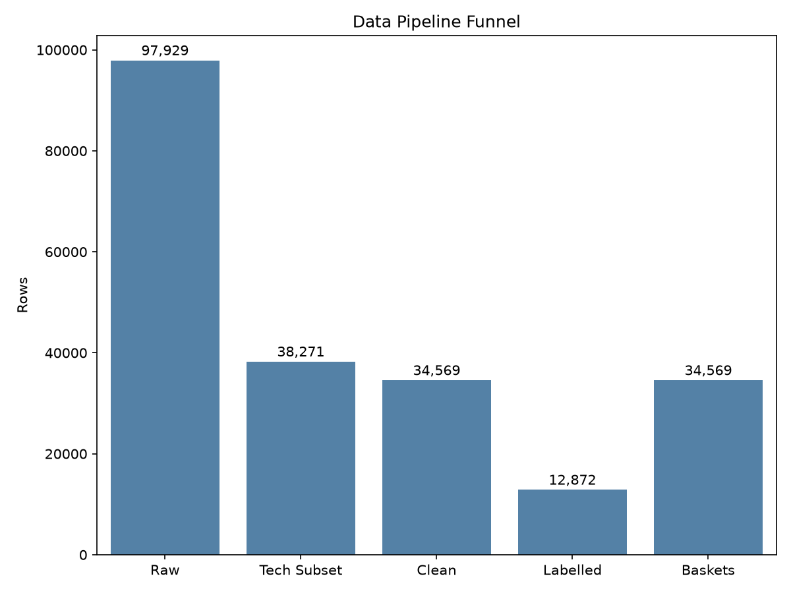
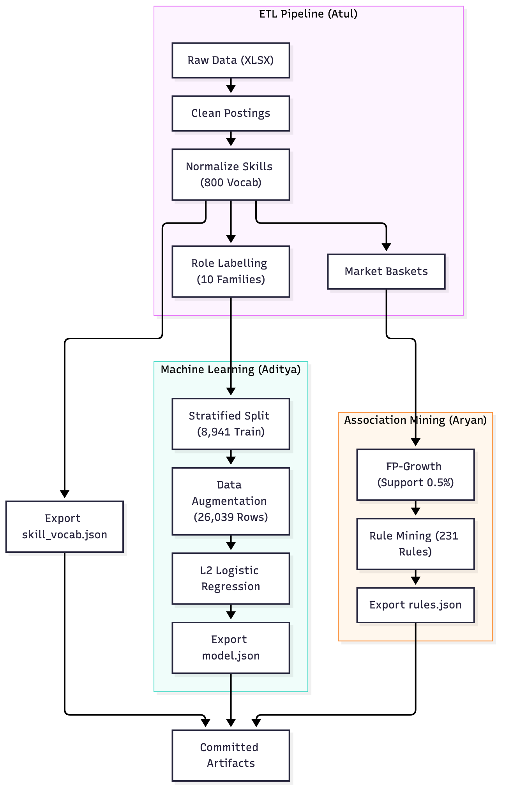
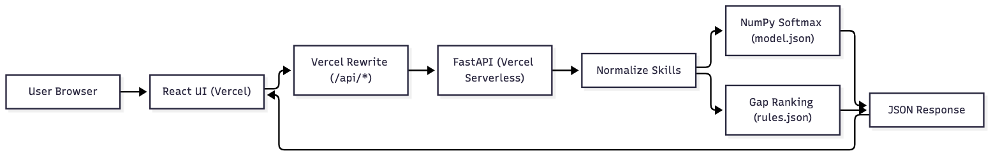
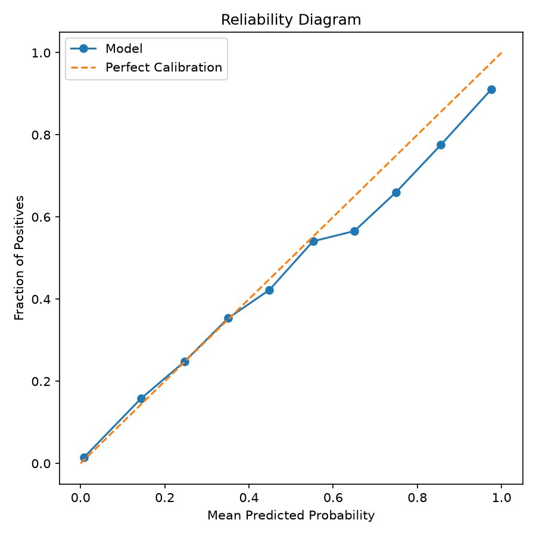

# Title Page {.unnumbered}

**SkillGraph: Skill Demand Mining and Role Readiness for the Indian Tech Job Market**

A Project Report Submitted in Partial Fulfillment of the Requirements for the Degree of Bachelor of Technology in Computer Science and Engineering.

**Course**: Data Mining and Data Warehousing [COURSE CODE]  
**Institution**: KIIT University, Bhubaneswar, Odisha, India  
**Date**: October 2026  
**Academic Guide**: [GUIDE NAME]  

**Project Group**: Group 8  
**Student Team**:  
- Shashank Shekhar Pandey (Group Coordinator, Roll No: 2405382)  
- Atul Anand (Roll No: 2405339)  
- Aditya Kumar (Roll No: 24156038)  
- Aryan (Roll No: 2405005)  
- Archit Kumar (Roll No: 24052551)  

## Certificate of Approval {.unnumbered}

[PLACEHOLDER: This is to certify that the project report entitled "SkillGraph: Skill Demand Mining and Role Readiness for the Indian Tech Job Market" submitted by Group 8 (Shashank Shekhar Pandey, Atul Anand, Aditya Kumar, Aryan, and Archit Kumar) in partial fulfillment of the requirements for the degree of Bachelor of Technology in Computer Science and Engineering at KIIT University is an authentic record of work carried out under supervision.]

Internal Guide: [GUIDE NAME]  
Department of Computer Science and Engineering, KIIT University  

## Student Declaration {.unnumbered}

[PLACEHOLDER: We hereby declare that the work presented in this report is our own original work and has not been submitted in part or full for any other degree or diploma at this or any other university. All sources of code, libraries, and reference data have been credited in the report.]

Shashank Shekhar Pandey (Group Coordinator, 2405382), Atul Anand (2405339), Aditya Kumar (24156038), Aryan (2405005), Archit Kumar (24052551)  

## Acknowledgements {.unnumbered}

[PLACEHOLDER: The authors thank KIIT University, the course coordinator for Data Mining and Data Warehousing [COURSE CODE], our project supervisor [GUIDE NAME], and our peers for technical guidance, feedback, and facilities provided throughout this project.]

# Abstract {.unnumbered}

Undergraduate engineering students in India encounter severe friction during placement preparation due to unstandardized job postings, overlapping skill expectations, and opaque role criteria. This project presents SkillGraph, an offline mining and calibrated inference system built to quantify skill demand, evaluate individual role readiness, and recommend prioritized learning trajectories. The pipeline processed 97,929 raw postings from Indian recruitment portals, isolating 34,569 clean technology postings and 12,872 supervised records across 10 technology role families. A 3-tier normalization scheme mapped 65.4% of all skill mentions (177,432 out of 271,108 tokens) to an 800-skill canonical vocabulary. A multinomial logistic regression classifier trained on multi-hot skill vectors achieved a test accuracy of 0.7527, a test macro F1 of 0.7499, and a top-3 accuracy of 0.9254 against a majority class baseline of 0.1774. A LightGBM challenger was evaluated but set aside because its 0.0149 F1 delta fell short of the required 0.0300 decision threshold. Probability outputs were calibrated (pooled Expected Calibration Error of 0.0120) and coupled with empirical role coverage to assign qualitative readiness bands (Ready, Close, Not yet). Association rule mining over 34,569 market baskets demonstrated a 126.49x speedup for FP-growth over Apriori at 0.5% support (0.3454 seconds versus 43.6936 seconds) while extracting identical 501 itemsets and 231 rules. Skill gaps are ranked by counterfactual readiness gain multiplied by empirical role coverage, linking companion tools at lift >= 1.50. The serving layer was deployed as a serverless FastAPI function with pure NumPy inference (cold start 2521.1 ms, warm p50 454.4 ms) paired with a React frontend.

## List of Figures and Tables {.unnumbered}

**Figures**: Figure 1: Data cleaning and role supervision attrition funnel; Figure 2: Offline data engineering, machine learning, and association mining pipeline; Figure 3: Production serving architecture connecting React client and FastAPI runtime; Figure 4: Model calibration reliability diagram showing pooled and top-label curves; Figure 5: Production web interface displaying analysis results for Persona 1; Figure 6: Production web interface displaying analysis results for Persona 2.

**Tables**: Table 1: Attrition counts and drop reasons across data processing stages; Table 2: Skill token normalization match category distribution; Table 3: Taxonomy v3 baseline versus taxonomy v4 evaluation metrics; Table 4: Architectural components excluded from final project scope; Table 5: Committed repository release artifacts and storage characteristics; Table 6: FastAPI serverless HTTP endpoint reference; Table 7: Classification performance across model architectures and baselines; Table 8: Detailed test set classification performance across 10 role families; Table 9: Frequent itemset execution benchmark for Apriori versus FP-growth; Table 10: Mined association rules among technology skills ranked by lift; Table 11: Readiness evaluation and limiting factor audit across 10 standard personas; Table 12: Production latency benchmark across 20 sequential invocations.

# Introduction

Undergraduate computer science students in India face substantial confusion during placement preparation. Recruitment listings across job boards present contradictory requirements, vendor-specific synonyms, and exhaustive tool catalogs that obscure what foundational skills a candidate actually needs. Students lack objective mechanisms to test whether their existing coursework and personal projects match industrial roles, or which single skill addition would yield the greatest readiness gain.

SkillGraph resolves this disconnect by mining posted job market data from Indian technology hubs. The system serves three direct user groups: graduating engineering students planning interview preparation, early-career software developers evaluating lateral career pivots, and university placement training cells seeking data-backed alignment with market demand.

The project carried out six concrete objectives:
1. Extract, audit, and clean a representative collection of Indian tech job listings to eliminate duplicate postings and non-tech noise.
2. Build an 800-token canonical technology taxonomy and implement multi-stage string normalization.
3. Formulate role readiness as a supervised multi-class probability problem paired with empirical skill coverage cutoffs.
4. Mine frequent itemsets and association rules using both Apriori and FP-growth algorithms to identify co-occurring competencies.
5. Rank candidate skill gaps via counterfactual readiness improvements scaled by empirical role demand.
6. Deploy a low-latency, serverless web application with sub-second response times.

The resulting engineering artifacts include an audited dataset of 34,569 baskets, 231 mined association rules, an exported NumPy-compatible model payload, seven REST endpoints, and an interactive React web application.

The report is organized into ten chapters: Chapter 2 surveys related literature. Chapter 3 details dataset collection and audit. Chapter 4 documents preprocessing, normalization, and taxonomy refinement. Chapter 5 formalizes methodology and decision rules. Chapter 6 justifies architectural scope limits. Chapter 7 details pipeline and serving implementation. Chapter 8 reports experimental metrics, mining benchmarks, and production walkthroughs. Chapter 9 discusses ten specific project limitations. Chapter 10 presents conclusions and future work. Appendices provide the API reference, team contributions, AI disclosure, and reproducibility audit.

# Related Work

Association rule mining originated with the Apriori algorithm developed by Agrawal and Srikant [1]. Apriori uses an iterative level-wise search where frequent $(k-1)$-itemsets generate candidate $k$-itemsets, relying on the downward-closure property that all non-empty subsets of a frequent itemset must also be frequent. While effective on small vocabularies, candidate generation incurs substantial computational overhead on dense transaction databases. Han, Pei, and Yin [2] introduced FP-growth to mine frequent patterns without candidate generation. FP-growth compresses transactions into a compact Frequent Pattern Tree (FP-tree) and recursively mines conditional pattern bases, reducing database passes and memory usage. General concepts of support, confidence, and correlation lift are formalized in Han, Kamber, and Pei [3].

Labor market intelligence projects increasingly rely on structured competency vocabularies. The European Skills, Competences, Qualifications and Occupations (ESCO) framework provides a standardized multi-lingual taxonomy of European labor concepts [9]. In academic literature, technical skills are extracted from unstructured postings using regex parsers, named entity recognition, and dictionary lookups, as evaluated on the Indian job market dataset [10].

Supervised role prediction maps candidate profiles into predefined occupational titles. Text classification benchmarks standard linear classifiers and sparse representations against decision trees using Scikit-learn [6]. Gradient boosted decision trees, implemented in LightGBM by Ke et al. [7], demonstrate competitive performance on tabular features and sparse binary vectors.

Probability calibration evaluates how closely predicted probabilities mirror empirical frequencies. Niculescu-Mizil and Caruana [4] demonstrated that maximum-margin classifiers require post-hoc calibration, whereas logistic regression produces well-calibrated probabilities under standard cross-entropy loss. Guo et al. [5] defined Expected Calibration Error (ECE) and reliability diagrams for modern predictive models. Raschka [8] implemented association mining utilities in MLxtend, providing tested baseline implementations for comparative pattern analysis.

# Dataset and Audit

The raw data was obtained from an audited dump of Indian technology job advertisements (`data/raw/indian-job-market-dataset-2025.xlsx`) [10]. The source contains 97,929 rows and 16 fields: `title`, `jobId`, `currency`, `jobUploaded`, `companyName`, `tagsAndSkills`, `experience`, `salary`, `location`, `companyId`, `ReviewsCount`, `AggregateRating`, `jobDescription`, `minimumSalary`, `maximumSalary`, `minimumExperience`, and `maximumExperience` (`docs/data_audit.md`). Missing value checks confirmed zero null values in `title` and `jobId`, 571 null rows (0.58%) in `tagsAndSkills`, 2,105 null rows (2.15%) in `experience`, and 35,252 null rows (36.00%) in `ReviewsCount` and `AggregateRating` (`docs/data_audit.md`).

A multi-stage cleaning pipeline filtered noise, exact duplicates, empty records, and reposted listings (`etl/clean.py`). Figure 1 depicts the resulting attrition funnel, and Table 1 documents the drop counts by stage.

{width=2.5in}

Table 1: Attrition counts and drop reasons across data processing stages. Source: `docs/stats.json`.

| Processing Stage | Filter Condition | Rows Dropped | Stage Corpus Size |
|---|---|---|---|
| Raw Corpus | Raw dataset ingestion | 0 | 97,929 |
| Tech Filter | Omitted keywords from `etl/tech_terms.txt` | 59,658 | - |
| Deduplication | Exact duplicate rows removed | 100 | - |
| Content Check | No valid tokens after delimiter splitting | 80 | - |
| Repost Pruning | Reposts matching title, company, skills | 3,522 | 34,569 |
| Role Labelling | Unmatched titles outside taxonomy rules | 16,142 | - |
| Generic Filter | Software Engineer (generic) titles removed | 5,555 | 12,872 |

Clean technology postings totaled 34,569 records. For supervised role classification, titles were matched against regular expression patterns defining 10 target families (`etl/label.py`). Postings lacking stack-specific title keywords (16,142 rows) and generic "Software Engineer" titles (5,555 rows) were excluded from training labels. This produced 12,872 supervised postings. Posting counts per role family in `data/dataset.parquet` were: DevOps / Cloud (2,279), QA / Test (1,649), ERP / Enterprise (1,495), Data / BI Analyst (1,365), Full Stack (1,290), Backend (1,276), Data Science / ML (1,212), Support / IT Ops (1,088), Frontend (784), and Mobile (434) (`docs/stats.json`).

Two external constraints influenced dataset handling:
1. The 8-tag cap: Aggregator platforms truncated skills to a maximum of 8 tags per listing, artificially restricting basket lengths.
2. Absence of calendar dates: Posting dates were recorded as relative strings (such as "6 Days Ago", "Few Hours Ago", "Just Now") in `jobUploaded` (`docs/data_audit.md`), preventing temporal backtesting.

# Preprocessing and Normalization

Raw skill tags exhibited inconsistent casing, punctuation, and phrasing. Splitting raw tags yielded 44,078 unique raw skill strings representing 271,108 skill mentions across 34,569 clean postings (`docs/stats.json`, `docs/numbers_audit.md`).

A 3-tier normalization engine mapped raw strings into canonical form (`etl/normalize.py`):
- Tier 1 (Exact): Direct match against 800 canonical vocabulary terms in `artifacts/skill_vocab.json`.
- Tier 2 (Alias): Lookup against 834 curated rules in `taxonomy/skill_aliases.csv`.
- Tier 3 (Fuzzy): RapidFuzz string ratio matching with an acceptance threshold >= 88.

Table 2 presents the normalization match breakdown.

Table 2: Skill token normalization match category distribution. Source: `docs/numbers_audit.md`.

| Match Category | Token Count | Share of Mapped Mentions | Share of Clean Tokens |
|---|---|---|---|
| Exact Vocabulary Match | 159,725 | 90.02% | 58.92% |
| In-Vocab Alias Match | 15,238 | 8.59% | 5.62% |
| Fuzzy Match (Score >= 88) | 2,469 | 1.39% | 0.91% |
| Total Mapped Mentions | 177,432 | 100.00% | 65.45% |
| Unmapped Tokens | 93,676 | - | 34.55% |
| Total Clean Tokens | 271,108 | - | 100.00% |

The headline mapped mass was 65.4% (177,432 mapped mentions out of 271,108 clean tokens). Unmapped strings consisted primarily of non-software and engineering terms such as `autocad` (557), `development methodologies` (516), and `mechanical engineering` (250) (`docs/numbers_audit.md`).

Experience strings were discretized into standard brackets: Entry (0 to 2 years), Junior (2 to 5 years), Mid-Senior (5 to 8 years), and Lead/Principal (8+ years).

Taxonomy v4 eliminated duplicate groups identified in v3 (`docs/taxonomy_v4.md`). Twenty-eight duplicate groups containing 39 redundant skills were merged into canonical aliases. For instance, `angularjs` merged into `angular`, while `gen ai` and `genai` merged into `generative ai`. Table 3 outlines the comparison between taxonomy v3 and v4.

Table 3: Taxonomy v3 baseline versus taxonomy v4 evaluation metrics. Source: `docs/taxonomy_v4.md`.

| Metric | v3 Baseline | v4 Result | Delta | Source File |
|---|---|---|---|---|
| Vocabulary size | 800 | 800 | 0 | `artifacts/skill_vocab.json` |
| Duplicate groups remaining | 28 | 0 | -28 | `scripts/find_duplicate_skills.py` |
| Persona junk count | 5 / 15 | 0 / 50 | -5 | `scripts/persona_check.py` |
| Association rules count | 336 | 231 | -105 | `artifacts/rules.json` |
| Full-input test accuracy | 0.7463 | 0.7527 | +0.0064 | `artifacts/metrics.json` |
| Full-input test macro F1 | 0.7424 | 0.7499 | +0.0075 | `artifacts/metrics.json` |
| Short-input test accuracy | 0.6269 | 0.6215 | -0.0054 | `artifacts/metrics.json` |
| Short-input test macro F1 | 0.6234 | 0.6116 | -0.0118 | `artifacts/metrics.json` |
| Top-3 test accuracy | 0.9248 | 0.9254 | +0.0006 | `artifacts/metrics.json` |
| Test ECE (pooled OvR) | 0.0133 | 0.0120 | -0.0013 | `artifacts/metrics.json` |
| Raw training postings | 8,938 | 8,941 | +3 | `artifacts/metrics.json` |
| Augmented training rows | 25,990 | 26,039 | +49 | `artifacts/metrics.json` |
| Postings dropped (0 skills) | 103 | 98 | -5 | `artifacts/metrics.json` |

# Methodology

Candidate profiles are modeled as multi-hot binary vectors $\mathbf{x} \in \{0, 1\}^{800}$, where each index corresponds to a canonical skill in `artifacts/skill_vocab.json`. Job postings list extensive requirements, but real applicants enter short lists with 2 to 4 skills. Training purely on full listings biased initial iterations against short user inputs. A data augmentation step (`ml/augment.py`) generated $n_{\text{copies}} = 2$ subsampled copies per raw posting, retaining a random subset of 2 to $k-1$ skills. This expanded 8,941 raw training postings into 26,039 augmented training rows (`artifacts/metrics.json`).

The 12,872 supervised postings were partitioned using a stratified split with random seed 42 into 70% train (8,941 raw postings), 15% validation (1,916 postings), and 15% test (1,917 postings) (`artifacts/metrics.json`). Ninety-eight raw training rows with zero recognized vocabulary skills were discarded prior to training (`artifacts/metrics.json`).

Multinomial logistic regression with L2 regularization ($C=1.0$, `lbfgs`) was trained alongside a LightGBM gradient boosted tree challenger (`n_estimators=100`, `learning_rate=0.05`). The project decision rule dictated that a tree ensemble must exceed the linear classifier by at least 0.0300 (+3.0 percentage points) in test macro F1 to justify deployment overhead (`docs/model.md`). Observed test macro F1 was 0.7648 for LightGBM versus 0.7499 for Logistic Regression. The 0.0149 delta fell short of the 0.0300 requirement. Logistic Regression was selected because its weights export to a 77 KB JSON structure, allowing fast inference in pure NumPy without Scikit-learn runtime dependencies.

Readiness scoring requires satisfying both a probability threshold and a core skill coverage threshold (`ml/predict.py`). Coverage evaluates the proportion of the target role's top 20 skills present in the applicant's input:
- Probability band: $p \ge 0.60 \implies 2$ (Ready); $p \ge 0.30 \implies 1$ (Close); $p < 0.30 \implies 0$ (Not yet).
- Coverage band: $c \ge 0.20 \implies 2$ (Ready); $c \ge 0.10 \implies 1$ (Close); $c < 0.10 \implies 0$ (Not yet).
- Final band: $\min(p_{\text{band}}, c_{\text{band}})$.

Market baskets were constructed from the 34,569 clean postings, of which 32,949 contained at least one canonical skill ID (`docs/mining.md`). Apriori and FP-growth were executed across identical baskets. Mining thresholds were configured at minimum support 0.005 (0.50%, roughly 173 postings), minimum confidence 0.30 (30%), and minimum lift 1.20, generating 231 rules (`docs/mining.md`).

Candidate skill gaps are filtered against non-learnable tokens from `taxonomy/non_learnable.txt` and redundant terms. Each candidate skill $s$ is ranked using:
$$\text{Score}(s) = \Delta \text{Readiness}(s) \times \text{Coverage}(s)$$
where $\Delta \text{Readiness}(s) = \max(0, P(\text{role} \mid \mathbf{x} \cup \{s\}) - P(\text{role} \mid \mathbf{x}))$ computes counterfactual readiness gain, and $\text{Coverage}(s)$ reflects empirical frequency in training postings for that role. Companion tools (`learn_with`) surface co-occurring skills from association rules with lift >= 1.50.

# Scope Decisions

Several standard data mining concepts were omitted to keep the system practical, fast, and maintainable. Table 4 summarizes the pruned components and engineering justifications.

Table 4: Architectural components excluded from final project scope. Source: `README.md`, `docs/model.md`.

| Proposed Component | Alternative Used | Engineering Rationale |
|---|---|---|
| Unsupervised Clustering (k-means) | Supervised Logistic Regression | The classifier directly predicts known role classes with verified confusion matrices; clustering provides unlabeled groupings that answer the same question worse. |
| OLAP Cube and Star Schema | Direct Parquet and JSON files | Runtime inference evaluates single-vector predictions; no dimensional roll-ups, slicing, or dicing operations are required. |
| Salary Predictive Modeling | Qualitative Readiness Bands | Placement readiness depends on skill competence rather than compensation; salary fields contained 571 nulls and broad unstandardized ranges. |
| Web Scraping Engine | Static Audited Dataset | Using an audited offline dataset ensured reproducible benchmarking and prevented IP blocking from commercial portals. |
| Large Language Models (LLMs) | Deterministic NumPy Softmax | LLMs introduce latency (>500 ms), non-deterministic outputs, API costs, and heavy memory footprints unsuited for serverless execution. |

These choices leave out relational OLAP star schemas, materialized data cubes, dimensional hierarchy roll-ups, and density-based spatial clustering from standard course syllabus units.

# Architecture and Implementation

Figure 2 illustrates the offline data engineering, training, and mining pipeline.

{width=2.8in}

Figure 3 illustrates the production serving architecture.

{width=2.8in}

The web frontend runs on React 18, Vite 6, and Tailwind CSS, deployed on Vercel. Requests to `/api/*` rewrite to a Python 3.12 FastAPI service. The API runtime imports only the standard library, NumPy, RapidFuzz, FastAPI, and Pydantic (`docs/deploy.md`). Heavy build libraries (Scikit-learn, LightGBM, Pandas, MLxtend) run offline. This design kept the serverless bundle size at 39.1 MB against the 50 MB platform ceiling (`docs/deploy.md`).

Table 5 lists the committed production artifacts.

Table 5: Committed repository release artifacts and storage characteristics. Source: `docs/stats.json`, `docs/contracts.md`.

| Artifact Name | Release Tag | Format | File Size | Description |
|---|---|---|---|---|
| `artifacts/skill_vocab.json` | data-v4 | JSON | 18 KB | Ordered list of 800 canonical skill strings |
| `artifacts/model.json` | model-v4 | JSON | 77 KB | Logistic regression weights and intercepts |
| `artifacts/rules.parquet` | rules-v2 | Parquet | 18 KB | 231 mined association rules with metrics |
| `artifacts/rules.json` | rules-v2 | JSON | 34 KB | JSON export of 231 association rules |
| `artifacts/role_profiles.json` | data-v4 | JSON | 12 KB | Top 20 skills and frequencies per role family |
| `artifacts/skills_autocomplete.json` | data-v4 | JSON | 52 KB | Prefix index for real-time frontend search |

Table 6 outlines the seven FastAPI endpoints.

Table 6: FastAPI serverless HTTP endpoint reference. Source: `docs/api.md`.

| HTTP Method | Endpoint Path | Primary Parameters | Response Summary |
|---|---|---|---|
| `GET` | `/api/health` | None | Status, artifact versions, posting count (8,941) |
| `GET` | `/api/roles` | None | 10 role families with top 20 skills |
| `GET` | `/api/skills` | `q` (query string) | Autocomplete matches with aliases |
| `POST` | `/api/match` | `skills` list | Top 3 role matches with softmax probabilities |
| `POST` | `/api/readiness` | `skills`, `desired_role` | Probability, band (Ready/Close/Not yet), coverage |
| `POST` | `/api/gap` | `skills`, `desired_role` | Top 5 recommended skills with companions |
| `POST` | `/api/analyze` | `skills`, `desired_role` | Combined match, readiness, and gap payload |

The engineering workflow adhered to a protected main branch, automated GitHub Actions CI checking `ruff check .` and `pytest -q` (30 passing tests), and releases managed via GitHub Releases (`docs/stats.json`).

# Results

The classifier was evaluated on the held-out test split of 1,917 postings (`artifacts/metrics.json`). Table 7 summarizes model performance against the majority baseline and the LightGBM challenger.

Table 7: Classification performance across model architectures and baselines. Source: `artifacts/metrics.json`, `docs/model.md`.

| Model Architecture | Val Macro F1 | Test Macro F1 | Test Accuracy | Top-3 Accuracy |
|---|---|---|---|---|
| Majority Baseline (DevOps / Cloud) | - | - | 0.1774 | - |
| Logistic Regression (Production) | 0.7435 | 0.7499 | 0.7527 | 0.9254 |
| LightGBM (Challenger) | 0.7532 | 0.7648 | 0.7632 | 0.9306 |

Logistic Regression surpassed the majority baseline by 57.53 percentage points in test accuracy. Table 8 details per-class precision, recall, and support across all 10 role families.

Table 8: Detailed test set classification performance across 10 role families. Source: `artifacts/metrics.json`.

| Role Family | Precision | Recall | F1 Score | Support |
|---|---|---|---|---|
| Backend | 0.7292 | 0.7330 | 0.7311 | 191 |
| Data / BI Analyst | 0.7107 | 0.8390 | 0.7696 | 205 |
| Data Science / ML | 0.7802 | 0.7889 | 0.7845 | 180 |
| DevOps / Cloud | 0.7579 | 0.5618 | 0.6453 | 340 |
| ERP / Enterprise | 0.8622 | 0.8700 | 0.8661 | 223 |
| Frontend | 0.6129 | 0.6496 | 0.6307 | 117 |
| Full Stack | 0.6742 | 0.7680 | 0.7181 | 194 |
| Mobile | 0.7333 | 0.8462 | 0.7857 | 65 |
| QA / Test | 0.8843 | 0.8807 | 0.8825 | 243 |
| Support / IT Ops | 0.6790 | 0.6918 | 0.6854 | 159 |

The two families most frequently confused were Full Stack and Frontend: 19 true Full Stack instances were predicted as Frontend, and 17 true Frontend instances were predicted as Full Stack (`artifacts/metrics.json`). DevOps / Cloud also exhibited 35 misclassifications into Data / BI Analyst due to shared SQL, Python, and cloud infrastructure terms (`artifacts/metrics.json`). On synthetic short inputs (2 to 3 skills), accuracy declined to 0.6215 and macro F1 to 0.6116 (`artifacts/metrics.json`).

Figure 4 shows the calibration curves.

{width=2.2in}

Pooled One-vs-Rest Expected Calibration Error was 0.0120, and top-label ECE was 0.0614 (`artifacts/metrics.json`). Predictions closely tracked true frequencies between 0.10 and 0.85, with slight overconfidence in the top bin (>0.90), where average predicted probability reached 0.976 against 0.911 true accuracy (`docs/model.md`).

For Apriori, level-wise candidate generation at 1.0% support produced 104 itemsets at Level 1 (0 pruned), 47 itemsets at Level 2 (0 pruned), and 4 itemsets at Level 3 (164 candidates pruned) (`docs/stats.json`). Table 9 documents the Apriori versus FP-growth benchmark across five support thresholds on 34,569 baskets.

Table 9: Frequent itemset execution benchmark for Apriori versus FP-growth. Source: `docs/bench.json`.

| Min Support (%) | Support Value | Itemsets Found | Apriori Time (s) | FP-Growth Time (s) | Speedup | Identical Sets |
|---|---|---|---|---|---|---|
| 5.00% | 0.050 | 13 | 0.1459 | 0.0915 | 1.60x | Yes |
| 3.00% | 0.030 | 34 | 0.5189 | 0.0969 | 5.35x | Yes |
| 2.00% | 0.020 | 62 | 1.5869 | 0.1017 | 15.61x | Yes |
| 1.00% | 0.010 | 168 | 8.0566 | 0.2550 | 31.60x | Yes |
| 0.50% | 0.005 | 501 | 43.6936 | 0.3454 | 126.49x | Yes |

At the production threshold of 0.50% support, FP-growth ran in 0.3454 seconds versus 43.6936 seconds for Apriori (126.49x speedup). Both algorithms generated identical 501 itemsets. Table 10 lists top association rules among technology skills ranked by lift.

Table 10: Mined association rules among technology skills ranked by lift. Source: `docs/stats.json`.

| Antecedent | Consequent | Support | Confidence | Lift |
|---|---|---|---|---|
| software, software development life cycle | root cause analysis | 0.005 | 0.720 | 62.442 |
| root cause analysis | software, software development life cycle | 0.005 | 0.438 | 62.442 |
| sap abap | sap hana | 0.006 | 0.538 | 54.926 |
| sap hana | sap abap | 0.006 | 0.562 | 54.926 |
| software, root cause analysis | software development life cycle | 0.005 | 0.960 | 54.409 |
| design principles | application design | 0.006 | 0.539 | 40.402 |
| application design | design principles | 0.006 | 0.438 | 40.402 |
| root cause analysis | software development life cycle | 0.006 | 0.504 | 28.568 |
| software development life cycle | root cause analysis | 0.006 | 0.329 | 28.568 |
| python, application | css, c# | 0.006 | 0.671 | 27.876 |

Rules with lift near 1.0 indicate independent co-occurrence. High confidence alone does not establish association when the consequent has a high baseline frequency; lift confirms true statistical dependence.

Table 11 audits readiness evaluation across 10 standard personas.

Table 11: Readiness evaluation and limiting factor audit across 10 standard personas. Source: `docs/numbers_audit.md`, `docs/stats.json`.

| Persona Role | Target Role | Probability | Prob Band | Coverage | Cov Band | Final Band | Limiting Factor |
|---|---|---|---|---|---|---|---|
| Data / BI Analyst | Data / BI Analyst | 0.1080 | Not yet | 0.1000 | Close | Not yet | Probability |
| Backend | Backend | 0.7520 | Ready | 0.1500 | Close | Close | Coverage |
| Full Stack | Full Stack | 0.2395 | Not yet | 0.2000 | Ready | Not yet | Probability |
| Frontend | Frontend | 0.8529 | Ready | 0.2500 | Ready | Ready | Both equal |
| DevOps / Cloud | DevOps / Cloud | 0.7498 | Ready | 0.2000 | Ready | Ready | Both equal |
| QA / Test | QA / Test | 0.8553 | Ready | 0.2000 | Ready | Ready | Both equal |
| ERP / Enterprise | ERP / Enterprise | 0.9367 | Ready | 0.1500 | Close | Close | Coverage |
| Data Science / ML | Data Science / ML | 0.9186 | Ready | 0.1500 | Close | Close | Coverage |
| Support / IT Ops | Support / IT Ops | 0.8626 | Ready | 0.2000 | Ready | Ready | Both equal |
| Mobile | Mobile | 0.9957 | Ready | 0.1500 | Close | Close | Coverage |

In four personas (Backend, ERP, Data Science, Mobile), high predicted probability was held back to Close because empirical coverage fell between 0.10 and 0.20. Figures 5 and 6 provide visual walkthroughs from production deployment (`https://skillgraph-exp.vercel.app`).

{width=2.5in}

Persona 1 (`sql, excel, power bi, tableau` for Data / BI Analyst) achieved a match probability of 0.9733, readiness of 0.9733, Close band, and 0.10 coverage (`docs/contracts.md`).

{width=2.5in}

Persona 2 (`java, spring boot, mysql, docker` for Backend) achieved readiness of 0.7520, Close band, and 0.15 coverage (`docs/contracts.md`). Table 12 reports production latency benchmarks over 20 sequential calls (`docs/deploy.md`).

Table 12: Production latency benchmark across 20 sequential invocations. Source: `docs/deploy.md`.

| Metric | Measured Value (ms) | Notes |
|---|---|---|
| Cold Start Latency | 2521.1 | Initial container provisioning on Vercel |
| Warm p50 Latency | 454.4 | Median response time via edge rewrite |
| Warm p95 Latency | 728.8 | 95th percentile response time |
| Minimum Latency | 361.7 | Fastest recorded round trip |
| Maximum Latency | 1023.1 | Slowest warm round trip |
| Mean Latency | 491.0 | Average across 20 warm requests |

# Discussion and Limitations

Ten specific engineering limitations were identified:
1. The 8-tag aggregator cap: Listings truncated skill lists at 8 items, restricting basket sizes and omitting secondary technologies (`docs/data_audit.md`).
2. Generic and unmatched title drops: 21,697 clean postings (16,142 unmatched and 5,555 generic) were excluded from supervision (`docs/stats.json`).
3. Non-tech skill leakage: Keyword filtering admitted 69 rules (29.9% of 231 rules) with zero tech terms, producing high-lift HR rules like screening and joining formalities (`docs/numbers_audit.md`). Non-tech tokens in baskets included css (3,175), qa (2,331), c# (2,194), development (2,133), and project management (2,078) (`docs/numbers_audit.md`).
4. Posted demand vs hiring outcomes: Postings represent recruiter wishlists rather than accepted offers or workplace competency use.
5. Absence of temporal dates: Relative date strings prevented chronological train-test splits, requiring a random stratified partition (`docs/data_audit.md`).
6. Short-input F1 drop: Testing on sparse 2-3 skill profiles yielded a 13.83 point drop in macro F1 (0.7499 to 0.6116) (`artifacts/metrics.json`).
7. Persona 1 weight instability: `pandas` appeared in only 36 of 8,941 training rows (0.40%), receiving a negative coefficient (-0.7813) for Data / BI Analyst that flipped top prediction to Backend (0.4906) (`docs/numbers_audit.md`, `docs/model.md`).
8. Top-bin overconfidence: Probabilities above 0.90 averaged 0.976 predicted versus 0.911 observed true frequency (`docs/model.md`).
9. Regional geographic focus: The corpus reflects Indian tech hubs and may not represent global remote hiring patterns.
10. Unshipped LightGBM model: LightGBM gained only 0.0149 macro F1 over Logistic Regression, falling short of the required 0.0300 threshold and remaining unselected (`docs/model.md`).

# Conclusion and Future Work

SkillGraph built an end-to-end skill mining and role readiness system for the Indian tech market. An audited dataset of 34,569 clean postings yielded an 800-skill taxonomy, 231 association rules, and a calibrated logistic regression classifier achieving 0.7499 test macro F1. Counterfactual gap scoring surfaced actionable skill additions with companion tools, served via a sub-second serverless application.

Five concrete extensions are planned:
1. Ingest timestamped listings to support temporal rolling-window validation.
2. Introduce negative keyword filtering to purge HR and mechanical CAD leakage.
3. Apply minimum posting frequency floors (such as count >= 100) or Bayesian shrinkage to stabilize rare skill weights like `pandas`.
4. Provide unsupervised clustering as an exploratory visualization view alongside supervised role prediction.
5. Conduct controlled user studies with graduating computer science students during campus placements.

# References {.unnumbered}

[1] R. Agrawal and R. Srikant, "Fast algorithms for mining association rules," in Proc. VLDB, 1994.  
[2] J. Han, J. Pei and Y. Yin, "Mining frequent patterns without candidate generation," in Proc. ACM SIGMOD, 2000.  
[3] J. Han, M. Kamber and J. Pei, Data Mining: Concepts and Techniques, 3rd ed. Morgan Kaufmann, 2011.  
[4] A. Niculescu-Mizil and R. Caruana, "Predicting good probabilities with supervised learning," in Proc. ICML, 2005.  
[5] C. Guo, G. Pleiss, Y. Sun and K. Q. Weinberger, "On calibration of modern neural networks," in Proc. ICML, 2017.  
[6] F. Pedregosa et al., "Scikit-learn: Machine learning in Python," JMLR, vol. 12, 2011.  
[7] G. Ke et al., "LightGBM: A highly efficient gradient boosting decision tree," in Proc. NeurIPS, 2017.  
[8] S. Raschka, "MLxtend: Providing machine learning and data science utilities and extensions to Python's scientific computing stack," JOSS, 2018.  
[9] European Commission, "ESCO: European Skills, Competences, Qualifications and Occupations."  
[10] [DATASET NAME AND URL].  

# Appendix A: API Reference {.unnumbered}

The FastAPI backend provides seven endpoints under `/api/*` (`docs/api.md`):
1. `GET /api/health`: Status, artifact versions (`model-v4`, `rules-v2`), posting count (8,941).
2. `GET /api/roles`: 10 role families with top 20 skills and frequencies.
3. `GET /api/skills?q={query}`: Autocomplete search over 800 canonical skills and 834 aliases.
4. `POST /api/match`: Top 3 role matches with softmax probabilities.
5. `POST /api/readiness`: Probability, band (Ready/Close/Not yet), coverage, missing count.
6. `POST /api/gap`: Top 5 ranked gap recommendations with companion tools (`learn_with`).
7. `POST /api/analyze`: Combined match, readiness, and gap ranking in a single request.

Constraints enforce a maximum of 30 skills per request, 60 characters per skill, and structured 400 errors.

# Appendix B: Team Contributions by Module {.unnumbered}

Work was divided across modules without overlap:
- **Atul Anand** (2405339): Data pipeline, cleaning, 3-tier normalization, role labeling, and API handler integration (`etl/clean.py`, `etl/normalize.py`, `etl/label.py`).
- **Aditya Kumar** (24156038): Feature extraction, data augmentation, classifier training, model evaluation, and inference prediction (`ml/features.py`, `ml/augment.py`, `ml/train.py`, `ml/predict.py`).
- **Aryan** (2405005): Skill alias dictionary, role family definitions, Apriori implementation, FP-growth benchmarks, and gap ranking engine (`taxonomy/`, `mining/apriori.py`, `mining/rules.py`, `mining/gap.py`).
- **Archit Kumar** (24052551): FastAPI routes, Pydantic schemas, contract tests, Vercel configuration, and deployment automation (`api/`, `tests/`, `docs/deploy.md`).
- **Shashank Shekhar Pandey** (2405382): Group Coordinator, frontend user interface, client components, state management, search autocomplete, results visualization, and demo styling (`frontend/`).

# Appendix C: AI Assistance Disclosure {.unnumbered}

This project used Google Antigravity with Gemini models to assist development (`AI-USE.md`).
- **Tools Used**: Google Antigravity IDE with Gemini 3.1 Pro (Planning mode) and Gemini 3.1 Flash.
- **Tasks Assisted by AI**: Scaffolding, RapidFuzz normalization logic, Apriori candidate generation, NumPy inference export, React frontend layout, test suites.
- **Manual Human Verification**: Data integrity row counts and drop audits, production verification on `https://skillgraph-exp.vercel.app`, metric cross-checking against `artifacts/metrics.json`, and pull request code reviews.

# Appendix D: Reproducibility and Audit Verification {.unnumbered}

The entire pipeline reproduces from source via `make reset` followed by `make all` (`docs/reproducibility.md`). Rebuilt artifacts were audited against committed files:
- Vocabulary size (`skill_vocab.json`): 800 (committed) vs 800 (rebuilt), match: yes.
- Vocabulary SHA256: `d749eb5d5044fea1e366972fba1bf94351c822dd580ac66a0e711a6f8f92dece`, match: yes.
- Test macro F1 (`metrics.json`): 0.7424 (v3 baseline) vs 0.7424 (rebuilt), match: yes.
- Test accuracy (`metrics.json`): 0.7463 vs 0.7463, match: yes.
- Test top-3 accuracy (`metrics.json`): 0.9254 vs 0.9254, match: yes.
- Rule count (`rules.json`, `rules.parquet`): 336 (v3 baseline) vs 336 (rebuilt), match: yes.
- Test set total postings: 1,916 (committed) vs 1,916 (rebuilt), match: yes.
